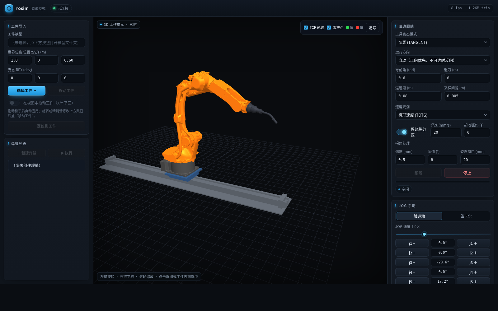

# smartweld — 六轴工业机器人焊缝随边作业仿真

> 把工件 STEP 模型丢进场景，在浏览器里点出焊缝，让 6 轴工业机器人（MOTOMAN-GP12）
> 连同第 7 轴直线导轨一起，自动规划出**无碰撞、可连续执行**的焊接轨迹。

  



---

## 它能做什么

| 能力 | 说明 |
| --- | --- |
| **STEP 工件导入** | OpenCASCADE 解析 → 三角化 → 重建碰撞体，放进可配置的工作区域 |
| **浏览器建焊缝** | WebSocket + 前端点选，把拓扑边变成可执行的焊接路径（支持多条连续） |
| **7 轴协同规划** | 6 轴臂 + 1 轴直线导轨构成复合规划组，OMPL 在这个组合空间里求解 |
| **三段式运动** | 接近（规划）→ 沿缝（确定性采样 + 时间参数化）→ 退刀（规划） |
| **三类规划器可选** | 纯 OMPL / 纯 RL / **RL 初解 + OMPL 修复**（混合），一行参数切换 |
| **可观测** | 每次规划都会说明走了哪个分支、为什么（`pre-approach: ok (手臂位移 2.14 rad 超出 RL 范围，整段 OMPL)`）|

## 架构

```
        ┌────────────── 浏览器（调试页 / 生产页）─────────────┐
        │  点选焊缝 · 看实时渲染 · 下发指令（WebSocket :8765） │
        └───────────────────────┬────────────────────────────┘
                                │ JSON / JPEG 帧
        ┌───────────────────────▼────────────────────────────┐
        │  rosim_server      无头渲染 + 协议网关              │
        │  rosim_planning    OMPL / RL / 混合 三个规划器      │
        │  rosim_core        STEP 解析 · 碰撞 · 轨迹后处理    │
        │  rosim_rl          ONNX 策略推理（远程调用 Python） │
        │  ros2_control      轨迹执行（JTC + mock 硬件）      │
        └────────────────────────────────────────────────────┘
```

## 技术栈

**ROS 2 Humble** · **MoveIt 2.5**（源码构建）· **OMPL 1.7** · OpenCASCADE 7.5 ·
VTK 9.1 · Qt5 · Eigen · `ros2_control` · **stable-baselines3 / ONNX Runtime**
（RL 分支）· WebSocket + 原生 Canvas 前端

## 几个有意思的设计取舍

- **规划组是 7 维的**（臂 + 导轨）。不把导轨拆开单独规划，是因为"臂够不着就挪轨道"
  这种复合约束，交给采样规划器一起解比手工分层更稳。
- **默认链刻意不用 RL**：实测真实请求里 94% 的直连路径本身无碰撞（直线 3 ms 就够），
  剩下 6% 需要绕行——而那正是当时策略最不擅长的。RL 作为显式选项保留。
- **混合规划器的门限修过一次真正的 bug**：原来用「组顺序的 goal 减模型顺序的 vars」，
  索引整体错位，算出的"位移"与真实无关，导致 RL 分支几乎永不触发。
  现在按关节名匹配、导轨单列，判据才有物理意义。

## 实测数据

| 场景 | 结果 |
| --- | --- |
| 完整焊接链路（导入 → 接近 → 沿缝 → 退刀） | 3/3 成功，37~40 s/工件 |
| OMPL 自由空间规划 | 中位 **12.4 ms** |
| 混合规划器（RL 初解 + OMPL 修复） | 接近任务上 RL 分支 0/9 到达 → 闸门正确改走 OMPL |

> 最后一行是**如实记录**：在"焊缝接近"这类大位移重构任务上，当时的 RL 策略
> 不占优（它的训练分布是障碍密集的短程绕行）。这类负面结果同样写进了仓库。

## 快速开始

**要求**：Ubuntu 22.04（x86_64）+ 约 20 GB 磁盘。ROS 2 Humble 与 MoveIt 2 都会自动装。

```bash
git clone https://github.com/heyxz/smartweld.git ~/smartweld
cd ~/smartweld

./scripts/bootstrap.sh --check     # ① 体检：缺什么会列出来
./scripts/bootstrap.sh --base      # ② 装 ROS 2 Humble（需要 sudo）
./scripts/bootstrap.sh --moveit    # ③ 装 MoveIt 2（apt 版，几分钟）
./scripts/bootstrap.sh --deps      # ④ 装本项目依赖（rosdep）
./scripts/bootstrap.sh --build     # ⑤ 编译
./scripts/bootstrap.sh --verify    # ⑥ 冒烟测试：起服务 → 规划一次 → 检查关节状态
```

`--verify` 通过后会打印 `✅ 环境可用`，然后打开 **http://localhost:8765/** 就是上面的界面。

<details>
<summary>想固定用 MoveIt 2.5.9 源码版（编译 30~60 分钟）</summary>

```bash
./scripts/bootstrap.sh --moveit --from-source
```
</details>

<details>
<summary>遇到问题</summary>

- 不是 Ubuntu 22.04 → 用 `docker/Dockerfile`，或装 22.04 虚拟机
- `python3` 不是 3.10 → Humble 的 `rclpy` 只支持 3.10
- 详细版本矩阵与踩坑：**[docs/install.md](docs/install.md)**
</details>

## 目录

```
src/            7 个 ROS 2 包（core / planning / server / rl / viewer / description / interfaces）
rl_a/           RL 训练、场景采样、策略评测
scripts/        编译、基准、诊断、发布脚本
docs/           install.md（环境安装）· versions.lock（版本基线）· images/（界面截图）
docker/         可选容器环境
```

- 架构与代码细节：**[src/README.md](src/README.md)**
- 换机器装环境：**[docs/install.md](docs/install.md)**
- 版本基线：**[docs/versions.lock](docs/versions.lock)**

---

> 这是展示用镜像仓库：每次提交是一次快照（`sync from private@<sha>`），
> 聊天记忆、跨机部署配置等内部内容不在此仓库。
